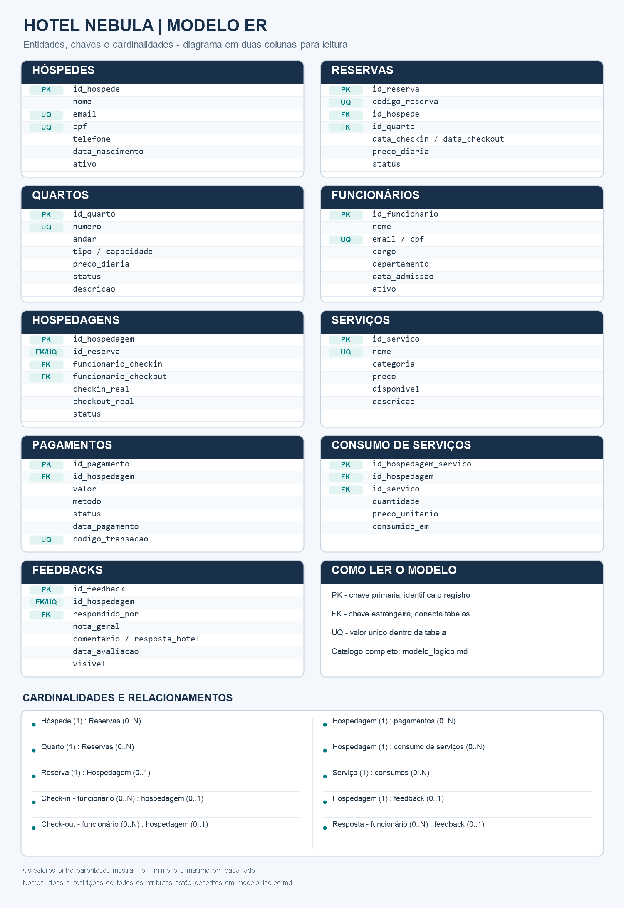

# Hotel Nebula

Projeto de banco de dados para gestao do Hotel Nebula, com modelagem relacional e documentos MongoDB.

## Entregas

- [Modelagem, diagrama ER e scripts SQL](Tabelas/8_HOTEL_NEBULA/README.md)
- [Modelagem e scripts MongoDB](Documentos/6_HOTEL_NEBULA/README.md)

## Diagrama ER

Os scripts SQL foram preparados para MySQL 8.0.16 ou superior. Os scripts MongoDB devem ser executados com `mongosh`.
