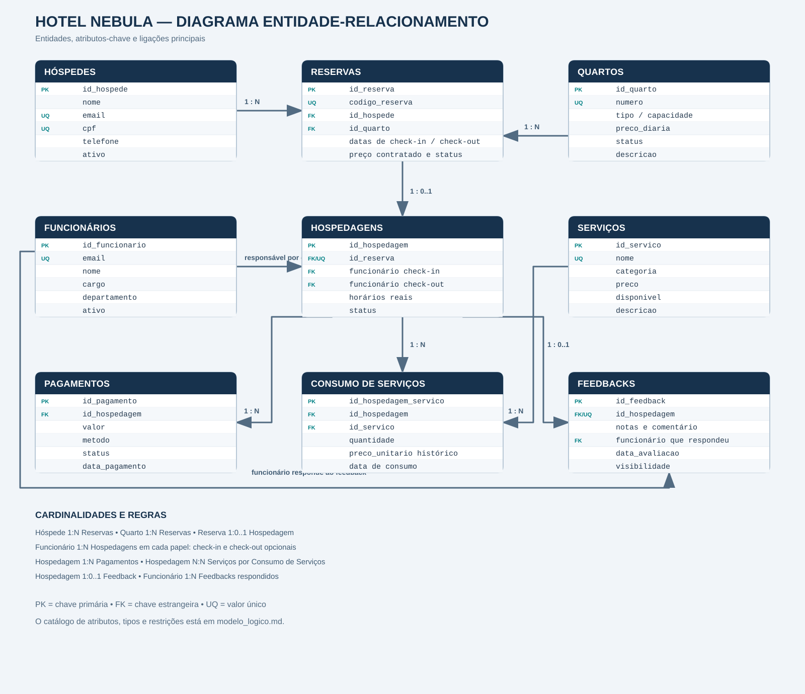

# Hotel Nebula 

A rede de Hotel Nebula está expandindo suas operações e precisa organizar digitalmente seus dados para melhorar reservas, hospedagens, serviços, avaliações de clientes e gestão dos quartos. A empresa quer desenvolver, no futuro, uma API de gestão hoteleira, mas antes disso precisa estruturar corretamente os dados.

### Objetivo geral

Desenvolver um projeto de banco de dados que percorra as etapas de:

- compreensão do problema
- modelagem dos dados
- implementação do banco
- extração e organização de dados

--- 

Crie um repositório no GitHub para o projeto e organize as entregas em três partes:

## Parte 1: Origem do Sistema

Em algum ponto entre a tecnologia, a organização e o caos elegante de um sistema mal planejado, existe o Hotel Nebula.

À primeira vista, ele parece apenas um hotel moderno: quartos confortáveis, reservas acontecendo a todo instante, hóspedes chegando de diferentes lugares, profissionais cuidando da operação, serviços extras sendo solicitados e avaliações aparecendo a cada nova estadia. Mas, por trás da recepção iluminada e das portas automáticas, existe um universo inteiro de dados tentando se organizar.

O problema é que esse universo ainda está disperso. O hotel tem informações sobre seus hóspedes, quartos, reservas, hospedagens, pagamentos, profissionais e avaliações, mas tudo isso está em sistemas diferentes, planilhas soltas ou até mesmo em papéis amassados. A equipe de gestão sabe que precisa colocar ordem nesse caos para melhorar a experiência dos clientes e otimizar a operação, mas não sabe por onde começar.

### Regras gerais do projeto

O sistema do hotel deve contemplar, no mínimo, elementos como:

- hóspedes
- quartos
- reservas
- hospedagens
- pagamentos
- profissionais/funcionários
- avaliações/comentários dos clientes

O que deve ser feito: 

- identificar as entidades principais do sistema
- identificar os relacionamentos entre elas
- levantar regras de negócio
- produzir o modelo conceitual
- transformar o modelo conceitual em um modelo lógico relacional

### Entregáveis:

- diagrama ER (Entidade-Relacionamento)
- descrição das entidades e relacionamentos

### Resposta

Modelagem conceitual em [modelo_conceitual.md](modelo_conceitual.md), com diagrama ER, entidades, cardinalidades e regras de negócio. O [modelo_logico.md](modelo_logico.md) detalha atributos, tipos, PKs e FKs das nove tabelas relacionais.

Diagrama visual em [modelo_ER.svg](modelo_ER.svg):

## Parte 2: Montagem do Núcleo

Foco: implementação física do banco relacional

Agora O profissional precisa construir a estrutura do banco de dados de forma funcional e consistente.

O que deve ser feito:
- criar o banco de dados
- criar as tabelas
- definir chaves primárias e estrangeiras
- aplicar restrições
- pensar em tipos de dados apropriados
- inserir dados iniciais para testes

Entregáveis: 
- script de criação do banco
- script de inserção de dados
- breve documentação explicando a estrutura criada

### Resposta

- [01_schema.sql](01_schema.sql): cria o banco e as nove tabelas, com chaves, índices e restrições.
- [02_seed_data.sql](02_seed_data.sql): insere dados de exemplo para seis hóspedes, oito quartos, cinco funcionários, seis serviços e o histórico de reservas/hospedagens.
- [modelo_logico.md](modelo_logico.md): documenta o esquema e as regras de negócio.

Execute primeiro `01_schema.sql` e depois `02_seed_data.sql` em MySQL 8.0.16 ou superior.

## Parte 3: Radar de Comando

Foco: consultas SQL e extração de dados

O hotel agora quer enxergar melhor sua operação. O profissional deve produzir consultas que gerem informações relevantes para gestão.

O que deve ser feito

Criar consultas que respondam perguntas como:

- quais quartos estão disponíveis em determinado período?
- quais hóspedes mais realizaram reservas?
- qual foi o faturamento por mês?
- quais serviços extras são mais consumidos?
- quais quartos receberam melhores avaliações?
- quais reservas foram canceladas?
- quantas hospedagens cada profissional atendeu?

### Resposta

As consultas estão em [03_consultas.sql](03_consultas.sql): disponibilidade por intervalo, hóspedes com mais reservas, faturamento mensal recebido, serviços mais consumidos, avaliações por quarto, reservas canceladas e atendimentos por funcionário.
