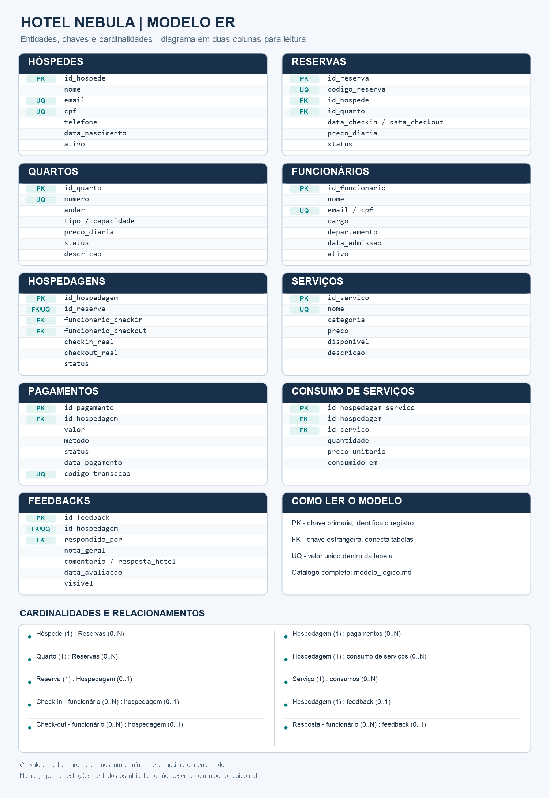
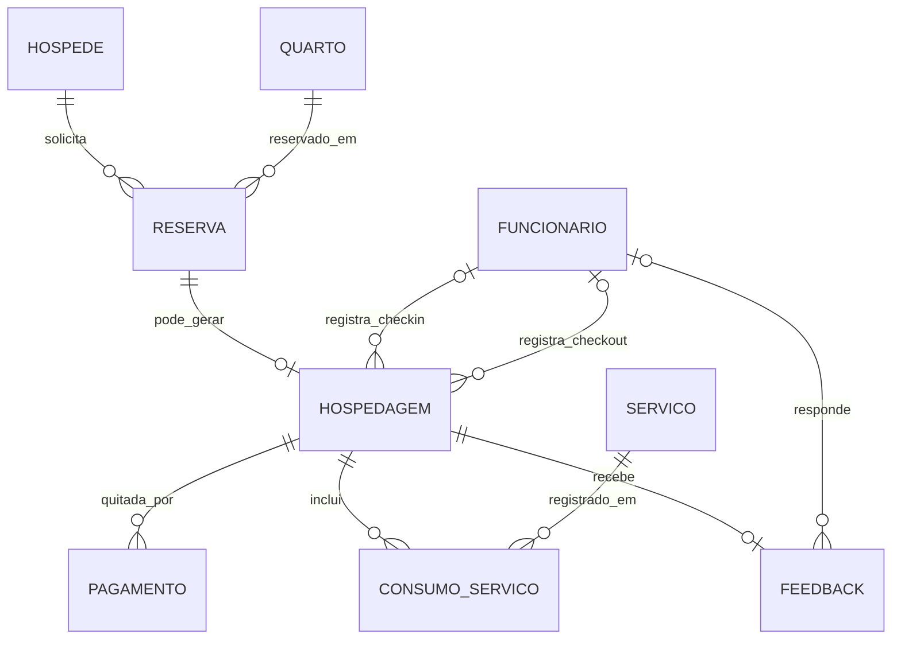

# Hotel Nebula — Modelo Conceitual

## Escopo

O modelo cobre o ciclo da hospedagem: cadastro do hóspede e do quarto, reserva, realização da estadia, consumo de serviços, cobrança e avaliação. O diagrama apresenta conceitos e relacionamentos do negócio; os tipos de dados e chaves físicas estão no [modelo lógico](modelo_logico.md).

## Diagrama visual

## Diagrama Entidade-Relacionamento

## Entidades

| Entidade | Responsabilidade no negócio |
|---|---|
| **Hóspede** | Pessoa que reserva e utiliza os serviços do hotel. |
| **Quarto** | Unidade física que pode ser reservada em períodos diferentes. |
| **Reserva** | Intenção confirmada ou cancelada de ocupar um quarto em um intervalo de datas. |
| **Hospedagem** | Registro da estadia efetivamente iniciada a partir de uma reserva. |
| **Serviço** | Item do catálogo que pode ser consumido durante uma hospedagem. |
| **Consumo de serviço** | Ocorrência de consumo, com quantidade, data e preço praticado. Resolve a relação muitos-para-muitos entre hospedagem e serviço. |
| **Pagamento** | Valor recebido ou processado para uma hospedagem; pode haver mais de um por estadia. |
| **Funcionário** | Profissional que pode registrar check-in, check-out ou responder uma avaliação. |
| **Feedback** | Avaliação escrita e notas dadas pelo hóspede após uma hospedagem. |

## Regras de negócio

1. Cada reserva pertence a um hóspede e solicita um quarto.
2. Uma reserva pode ser cancelada ou pode gerar no máximo uma hospedagem.
3. Uma hospedagem corresponde à estadia real; check-in e check-out registram os horários efetivos.
4. Uma hospedagem pode ter vários pagamentos e consumir vários serviços. O mesmo serviço pode ser consumido em várias hospedagens.
5. O consumo guarda o preço aplicado naquele momento, mesmo que o preço atual do catálogo mude.
6. Uma hospedagem pode receber no máximo um feedback; o feedback é associado ao hóspede e ao quarto por meio da hospedagem e da reserva.
7. Check-in, check-out e resposta ao feedback podem ser atribuídos a funcionários diferentes.
8. Reservas ativas do mesmo quarto não podem ocupar intervalos sobrepostos. O intervalo usa check-in inclusivo e check-out exclusivo, permitindo que uma nova estadia comece no dia da saída anterior.
