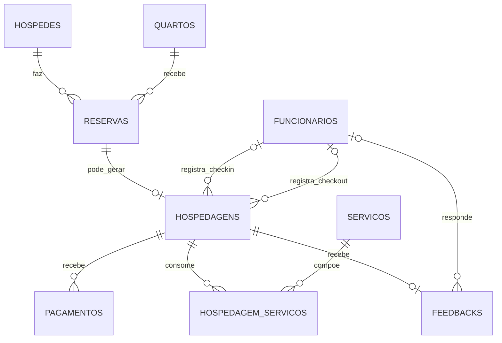

# Hotel Nebula — Modelo Lógico

Modelo relacional correspondente ao esquema MySQL dos arquivos `01_schema.sql` e `02_seed_data.sql`. O modelo conceitual de negócio está em [modelo_conceitual.md](modelo_conceitual.md).

## Diagrama ER

## Entidades e regras

| Tabela | Dados principais | Relacionamentos e regras |
|---|---|---|
| `hospedes` | Nome, e-mail, CPF, telefone, nascimento e situação do cadastro. | E-mail único; CPF único quando informado. Um hóspede pode fazer várias reservas. |
| `quartos` | Número, andar, tipo, capacidade, diária e situação operacional. | Número único; capacidade positiva; diária não negativa. Um quarto pode aparecer em várias reservas em períodos diferentes. |
| `reservas` | Código, hóspede, quarto, datas, quantidade de hóspedes, diária contratada, canal e situação. | Cada reserva pertence a um hóspede e a um quarto. A data de saída deve ser posterior à entrada. O código é único. |
| `hospedagens` | Reserva, horários reais de entrada e saída, funcionários responsáveis e situação da estadia. | Uma reserva gera no máximo uma hospedagem (`id_reserva` único). A saída real pode ficar vazia enquanto a hospedagem estiver aberta. |
| `pagamentos` | Hospedagem, valor, método, situação, data e identificador da transação. | Uma hospedagem pode ter vários pagamentos, permitindo parcelas ou meios de pagamento diferentes. |
| `funcionarios` | Nome, documentos, contato, cargo, departamento, admissão e situação. | Funcionários podem registrar check-in, check-out e responder feedbacks. |
| `servicos` | Nome, categoria, descrição, preço e disponibilidade. | Catálogo independente das hospedagens; o preço cobrado fica registrado como snapshot em `hospedagem_servicos`. |
| `hospedagem_servicos` | Hospedagem, serviço, quantidade, preço unitário contratado e horário de consumo. | Resolve a relação N:N entre hospedagens e serviços e preserva o preço do momento do consumo. |
| `feedbacks` | Hospedagem, notas, comentário, resposta do hotel e visibilidade. | Cada hospedagem pode receber no máximo um feedback. Hóspede e quarto são encontrados pela hospedagem e pela reserva relacionada. |

## Regras de negócio

1. Reservas canceladas não ocupam o quarto.
2. Para evitar conflito, intervalos se sobrepõem quando `reserva.data_checkin < novo_checkout` e `reserva.data_checkout > novo_checkin`. O script de consultas aplica essa regra; a aplicação deve validá-la também ao confirmar uma reserva.
3. A diária registrada na reserva preserva o preço combinado, mesmo que o preço atual do quarto mude.
4. Pagamentos com situação `pago` e data preenchida compõem o faturamento recebido. Pagamentos pendentes ou estornados ficam fora do total.
5. Quantidade consumida deve ser positiva; preços e notas têm limites definidos por restrições `CHECK`.
6. `hospedagem_servicos` armazena o preço no momento do consumo para manter o histórico financeiro.

## Índices e integridade

O esquema define chaves primárias e estrangeiras, unicidade para e-mails, CPFs, números de quartos, códigos de reserva e identificadores de transação, além de índices para busca por quarto/período, hóspede, pagamentos e avaliações. As tabelas usam InnoDB e `utf8mb4`.

## Catálogo lógico de atributos

`PK` indica chave primária, `FK` chave estrangeira, `UQ` valor único e `AI` incremento automático. Restrições `CHECK` e valores padrão estão detalhados em `01_schema.sql`.

| Tabela | Atributo | Tipo | Restrições |
|---|---|---|---|
| `hospedes` | `id_hospede` | `INT UNSIGNED` | PK, AI |
| `hospedes` | `nome` | `VARCHAR(100)` | NOT NULL |
| `hospedes` | `email` | `VARCHAR(150)` | NOT NULL, UQ |
| `hospedes` | `cpf` | `VARCHAR(14)` | UQ, opcional |
| `hospedes` | `telefone` | `VARCHAR(20)` | opcional |
| `hospedes` | `data_nascimento` | `DATE` | opcional |
| `hospedes` | `nacionalidade` | `VARCHAR(60)` | opcional |
| `hospedes` | `data_cadastro` | `DATETIME` | NOT NULL, padrão atual |
| `hospedes` | `ativo` | `BOOLEAN` | NOT NULL, padrão TRUE |
| `quartos` | `id_quarto` | `INT UNSIGNED` | PK, AI |
| `quartos` | `numero` | `VARCHAR(10)` | NOT NULL, UQ |
| `quartos` | `andar` | `SMALLINT` | NOT NULL |
| `quartos` | `tipo` | `VARCHAR(50)` | NOT NULL |
| `quartos` | `capacidade` | `SMALLINT UNSIGNED` | NOT NULL, maior que zero |
| `quartos` | `preco_diaria` | `DECIMAL(10,2)` | NOT NULL, não negativo |
| `quartos` | `status` | `ENUM` | NOT NULL, padrão `disponivel` |
| `quartos` | `descricao` | `VARCHAR(500)` | opcional |
| `funcionarios` | `id_funcionario` | `INT UNSIGNED` | PK, AI |
| `funcionarios` | `nome` | `VARCHAR(100)` | NOT NULL |
| `funcionarios` | `cpf` | `VARCHAR(14)` | UQ, opcional |
| `funcionarios` | `email` | `VARCHAR(150)` | NOT NULL, UQ |
| `funcionarios` | `telefone` | `VARCHAR(20)` | opcional |
| `funcionarios` | `cargo` | `VARCHAR(60)` | NOT NULL |
| `funcionarios` | `departamento` | `VARCHAR(60)` | NOT NULL |
| `funcionarios` | `data_admissao` | `DATE` | NOT NULL |
| `funcionarios` | `ativo` | `BOOLEAN` | NOT NULL, padrão TRUE |
| `reservas` | `id_reserva` | `INT UNSIGNED` | PK, AI |
| `reservas` | `codigo_reserva` | `VARCHAR(20)` | NOT NULL, UQ |
| `reservas` | `id_hospede` | `INT UNSIGNED` | FK → `hospedes` |
| `reservas` | `id_quarto` | `INT UNSIGNED` | FK → `quartos` |
| `reservas` | `data_checkin` | `DATE` | NOT NULL |
| `reservas` | `data_checkout` | `DATE` | NOT NULL, posterior ao check-in |
| `reservas` | `num_hospedes` | `SMALLINT UNSIGNED` | NOT NULL, padrão 1 |
| `reservas` | `preco_diaria` | `DECIMAL(10,2)` | NOT NULL, preço combinado |
| `reservas` | `status` | `ENUM` | NOT NULL, padrão `confirmada` |
| `reservas` | `canal` | `VARCHAR(30)` | NOT NULL, padrão `site` |
| `reservas` | `observacoes` | `VARCHAR(500)` | opcional |
| `reservas` | `data_criacao` | `DATETIME` | NOT NULL, padrão atual |
| `hospedagens` | `id_hospedagem` | `INT UNSIGNED` | PK, AI |
| `hospedagens` | `id_reserva` | `INT UNSIGNED` | FK → `reservas`, UQ |
| `hospedagens` | `id_funcionario_checkin` | `INT UNSIGNED` | FK → `funcionarios`, opcional |
| `hospedagens` | `id_funcionario_checkout` | `INT UNSIGNED` | FK → `funcionarios`, opcional |
| `hospedagens` | `checkin_real` | `DATETIME` | NOT NULL |
| `hospedagens` | `checkout_real` | `DATETIME` | opcional |
| `hospedagens` | `status` | `ENUM` | NOT NULL, padrão `em_andamento` |
| `hospedagens` | `observacoes` | `VARCHAR(500)` | opcional |
| `servicos` | `id_servico` | `INT UNSIGNED` | PK, AI |
| `servicos` | `nome` | `VARCHAR(100)` | NOT NULL, UQ |
| `servicos` | `categoria` | `VARCHAR(50)` | NOT NULL |
| `servicos` | `descricao` | `VARCHAR(500)` | opcional |
| `servicos` | `preco` | `DECIMAL(10,2)` | NOT NULL, não negativo |
| `servicos` | `disponivel` | `BOOLEAN` | NOT NULL, padrão TRUE |
| `hospedagem_servicos` | `id_hospedagem_servico` | `INT UNSIGNED` | PK, AI |
| `hospedagem_servicos` | `id_hospedagem` | `INT UNSIGNED` | FK → `hospedagens` |
| `hospedagem_servicos` | `id_servico` | `INT UNSIGNED` | FK → `servicos` |
| `hospedagem_servicos` | `quantidade` | `SMALLINT UNSIGNED` | NOT NULL, maior que zero |
| `hospedagem_servicos` | `preco_unitario` | `DECIMAL(10,2)` | NOT NULL, snapshot do preço |
| `hospedagem_servicos` | `consumido_em` | `DATETIME` | NOT NULL |
| `pagamentos` | `id_pagamento` | `INT UNSIGNED` | PK, AI |
| `pagamentos` | `id_hospedagem` | `INT UNSIGNED` | FK → `hospedagens` |
| `pagamentos` | `valor` | `DECIMAL(10,2)` | NOT NULL, maior que zero |
| `pagamentos` | `metodo` | `ENUM` | NOT NULL |
| `pagamentos` | `status` | `ENUM` | NOT NULL, padrão `pendente` |
| `pagamentos` | `data_pagamento` | `DATETIME` | opcional |
| `pagamentos` | `codigo_transacao` | `VARCHAR(100)` | UQ, opcional |
| `feedbacks` | `id_feedback` | `INT UNSIGNED` | PK, AI |
| `feedbacks` | `id_hospedagem` | `INT UNSIGNED` | FK → `hospedagens`, UQ |
| `feedbacks` | `nota_geral` | `DECIMAL(2,1)` | NOT NULL, de 1 a 5 |
| `feedbacks` | `nota_limpeza` | `TINYINT UNSIGNED` | opcional, de 1 a 5 |
| `feedbacks` | `nota_atendimento` | `TINYINT UNSIGNED` | opcional, de 1 a 5 |
| `feedbacks` | `nota_conforto` | `TINYINT UNSIGNED` | opcional, de 1 a 5 |
| `feedbacks` | `comentario` | `VARCHAR(1000)` | opcional |
| `feedbacks` | `resposta_hotel` | `VARCHAR(1000)` | opcional |
| `feedbacks` | `respondido_por` | `INT UNSIGNED` | FK → `funcionarios`, opcional |
| `feedbacks` | `data_avaliacao` | `DATETIME` | NOT NULL, padrão atual |
| `feedbacks` | `visivel` | `BOOLEAN` | NOT NULL, padrão TRUE |
